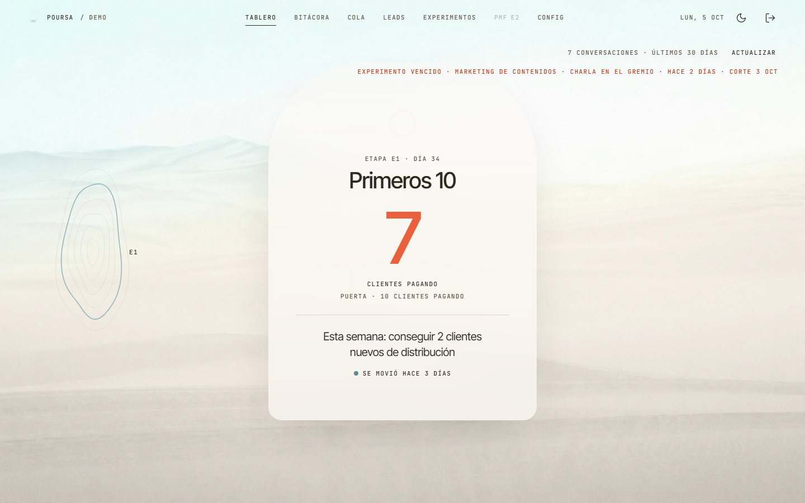
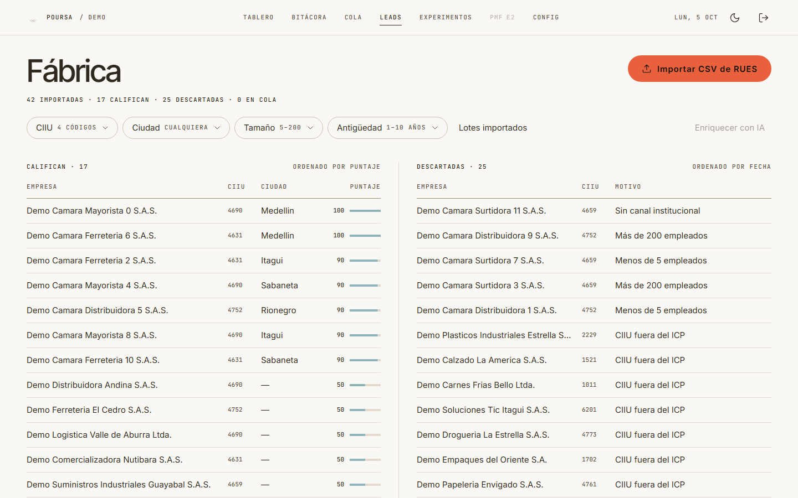
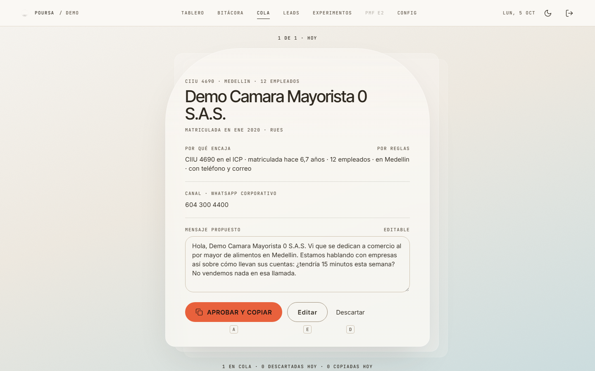
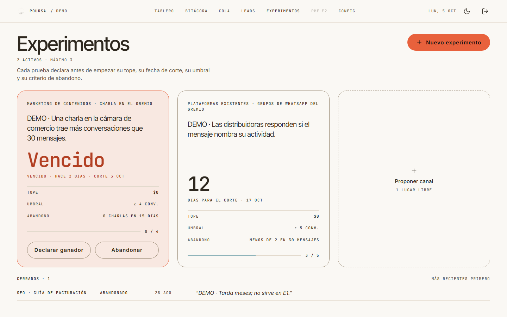
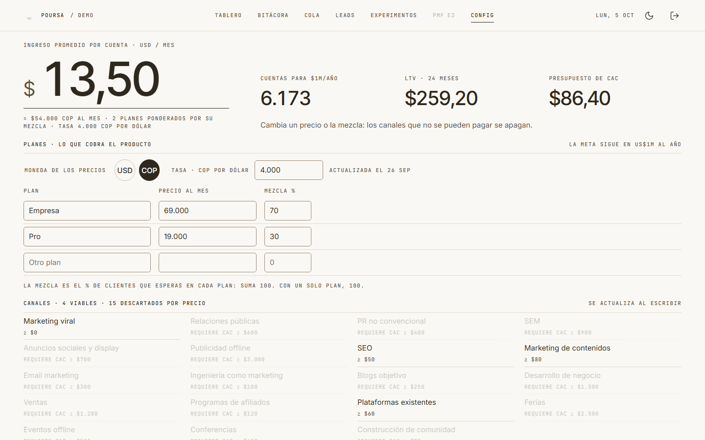
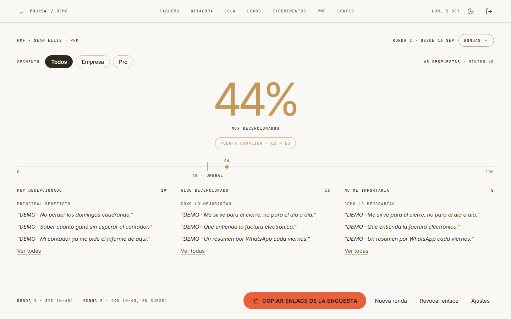
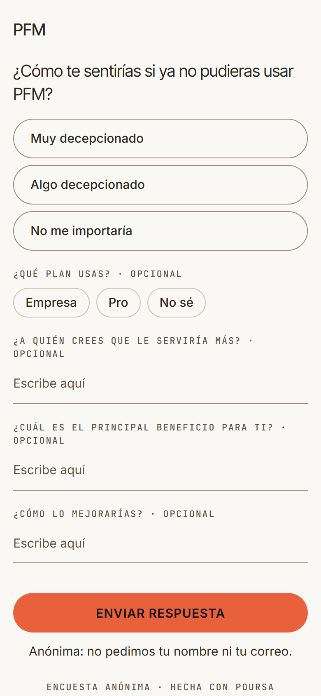
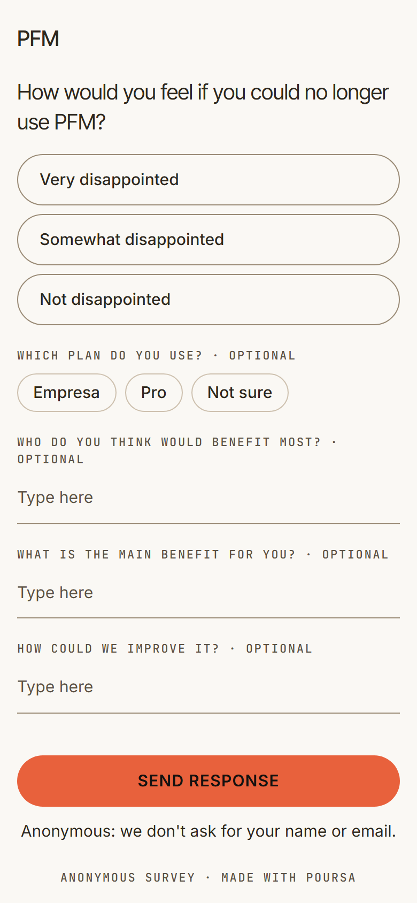
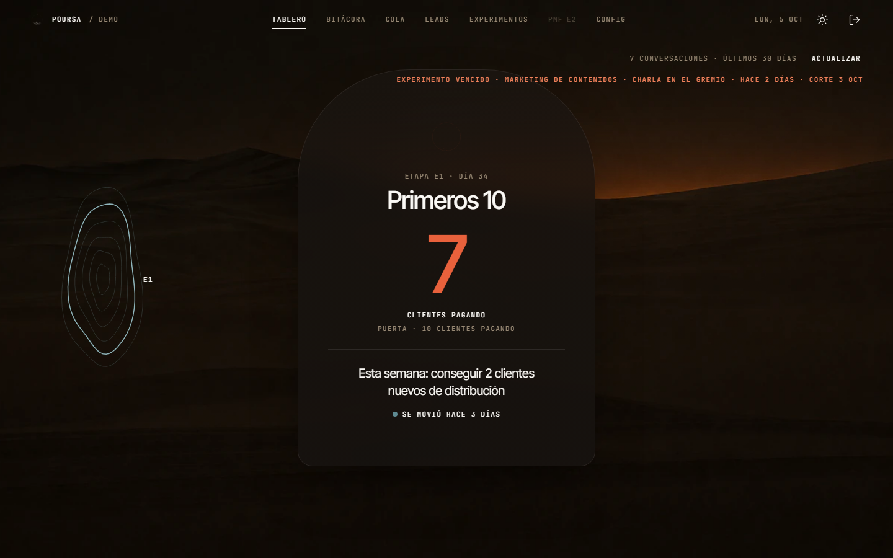

# POURSA

**El instrumento para conseguir los primeros clientes de un producto que ya está hecho.**

Cadencia, diagnóstico y disciplina de distribución para MVPs terminados que todavía
no venden: lo que hace una aceleradora, convertido en un sistema que se usa todos los días.

 

> **In English.** POURSA is a traction system for founders whose product is finished but
> has no paying customers yet. It turns what accelerators do — weekly cadence, stage
> gates, channel experiments, lead qualification and product-market-fit measurement —
> into a daily tool. It automates everything *up to* the conversation with a customer and
> nothing beyond it: messages are copied, never sent automatically, and the system never
> promises results. Built with Java 21 and Spring Boot 4, audited against OWASP ASVS 5.0
> level 2. Its first project is PFM, a personal and business finance app for Colombia.

---

## El problema

Construir un MVP hoy es más fácil que nunca. Venderlo, no. La mayoría de productos que
mueren no mueren por el código: **el 43% muere por falta de encaje con el mercado**, y la
mediana para llegar a US$1M de ingreso anual son 33 meses de distribución constante.

El síntoma es siempre el mismo: producto terminado, auditado, desplegable… y cero clientes
que pagan. Las aceleradoras resuelven eso con cadencia y criterio, pero cuestan, son
pocas y atienden a pocos. POURSA lleva ese método a un sistema.

Nace de un caso real: **PFM**, una aplicación de finanzas personales y de empresa con el
código terminado y ningún cliente pagando. POURSA es la herramienta para cambiar eso, y
PFM es su primer proyecto.

---

## Cómo funciona

### Una escalera, una métrica por etapa

Cada proyecto está en una etapa. Cada etapa tiene **una sola métrica** y **una puerta**
que se comprueba con datos, no con opiniones.

| Etapa | Nombre | La métrica | La puerta |
|---|---|---|---|
| **E0** | Señal | Conversaciones de descubrimiento | 30 conversaciones |
| **E1** | Primeros 10 | Clientes pagando | 10 clientes pagando de verdad |
| **E2** | Repetibilidad | PMF · "muy decepcionados" | 40% o más, con al menos 40 respuestas |
| **E3** | Canal | Un canal con costo de adquisición sano | CAC menor que un tercio del valor del cliente |
| **E4** | Motor | Clientes que llegan por bucles | 30% de los nuevos |
| **E5** | Escala | Ingreso recurrente anual | US$1M |

Solo se ve la etapa actual: el mapa completo paraliza.

### Cinco motores

| Motor | Qué hace |
|---|---|
| **Diagnóstico** | Dice en qué etapa está el proyecto, medido y no declarado. En E2, con la encuesta de Sean Ellis. |
| **Objetivo** | La escalera: la métrica de la etapa, el semáforo, la meta de la semana y la graduación con evidencia. |
| **Canal** | El precio decide qué canales se pueden pagar. Los que no, se apagan con su porqué. |
| **Fábrica de leads** | Importa empresas del registro mercantil, las califica con reglas explicables y prepara el contacto. |
| **Aprendizaje** | Experimentos de canal con contrato: tope, fecha de corte, umbral y criterio de abandono, declarados antes de empezar. |

---

## Las pantallas

<table>
<tr>
<td width="62%"></td>
<td><b>Fábrica de leads.</b> Importa el CSV del registro mercantil (RUES) con vista previa, y
califica cada empresa con reglas deterministas: actividad económica, ciudad, tamaño,
antigüedad y canal. <b>Descartar es la función principal</b>: las descartadas se muestran
con su motivo y con el mismo peso visual que las que califican. Las personas naturales no
entran nunca.</td>
</tr>
<tr>
<td></td>
<td><b>Cola de contacto.</b> Una empresa a la vez, con por qué encaja, el canal institucional
y un mensaje redactado a partir de una plantilla. <b>Nada se envía solo</b>: el botón copia
el mensaje, y la persona lo pega y lo envía. Cada versión de plantilla lleva la cuenta de
cuántas conversaciones trajo.</td>
</tr>
<tr>
<td></td>
<td><b>Experimentos.</b> Hasta tres a la vez, cada uno con su contrato. Cuando llega la fecha
de corte, el experimento solo se puede cerrar: ganador o abandonado, y lo aprendido es
obligatorio. El avance cuenta conversaciones reales, no actividad.</td>
</tr>
<tr>
<td></td>
<td><b>Configuración.</b> Los planes del producto en pesos o dólares, con su mezcla. De ahí
salen el ingreso promedio por cuenta, cuántas cuentas hacen falta para US$1M al año y el
presupuesto de adquisición que el precio permite. Con eso se decide qué canales se pueden
probar.</td>
</tr>
<tr>
<td></td>
<td><b>PMF.</b> La encuesta de Sean Ellis, para cualquier empresa: por plan, por rondas y con
las tres preguntas abiertas del método. Con menos de 40 respuestas la cifra se atenúa y dice
cuántas faltan; nunca se declara un encaje con una muestra que no alcanza.</td>
</tr>
</table>

<table>
<tr>
<td width="33%"></td>
<td width="33%"></td>
<td width="33%"></td>
</tr>
<tr>
<td><b>Bitácora</b> · cada conversación con un cliente en menos de un minuto, desde el celular. Es lo que alimenta todo lo demás.</td>
<td colspan="2"><b>La encuesta que reciben los clientes de la empresa</b> · con su marca, en español o inglés, sin cuenta y anónima por diseño: no hay dónde escribir un nombre, un correo ni un teléfono.</td>
</tr>
</table>

<b>Tema oscuro</b> · las dos apariencias se diseñaron a la vez, con los mismos contrastes mínimos de accesibilidad (WCAG AA).

---

## Principios

Lo que POURSA **no** hace, a propósito:

- **No promete resultados.** Informa; no sabe si vas a vender. Ningún texto, ninguna
  pantalla y ningún dato promete reuniones ni ventas.
- **No automatiza la conversación con el cliente.** Consigue, califica y prepara; hablar
  le toca a una persona, porque ahí está todo el aprendizaje.
- **No envía nada por su cuenta.** Copia; la persona pega y envía.
- **No trabaja con datos personales.** Solo datos institucionales de empresas (Ley 1581
  de 2012 de Colombia): correo institucional y teléfono corporativo.
- **No lee la base de datos de nadie.** Recibe las métricas que el negocio escribe o
  exporta. Un producto que exige acceso a la base del cliente no se puede vender.
- **Puede decir "detén esto".** Si la métrica lleva seis semanas quieta, lo dice sin
  suavizarlo.

---

## Stack

| | |
|---|---|
| **Lenguaje** | Java 21 |
| **Framework** | Spring Boot 4.1 (Spring MVC, Spring Security 7, Spring Data JPA) |
| **Base de datos** | MySQL 8, con migraciones versionadas e idempotentes |
| **Interfaz** | Thymeleaf y HTMX 2, sin frameworks de JavaScript; tipografía y marca propias, generadas por código |
| **Trabajos en segundo plano** | JobRunr |
| **IA** | Claude (Anthropic), opcional y desconectada por defecto, con gasto acotado por día y por lote |
| **Despliegue** | Docker: imagen mínima con JRE, usuario sin privilegios, MySQL con TLS obligatorio |

La arquitectura es un **monolito modular organizado por funcionalidad**: cada motor es un
módulo con su lógica, sus vistas y sus datos, y los módulos se hablan por interfaces
pequeñas, sin dependencias circulares.

---

## Seguridad

Auditada contra **OWASP ASVS 5.0 nivel 2** y el **OWASP Top 10:2025**, con un control por
prueba automatizada siempre que se puede.

- **Acceso:** sesión con cookie `HttpOnly`, `Secure` y `SameSite=Strict`, que rota al entrar
  y caduca. Bloqueo tras intentos fallidos, por usuario y dirección. Claves con bcrypt.
- **Cabeceras:** CSP estricta sin scripts ni estilos en línea, `X-Frame-Options`,
  `nosniff`, HSTS, `Permissions-Policy` y `Cross-Origin-Opener-Policy`.
- **Datos:** cada consulta se filtra por proyecto. SQL siempre con parámetros. Exportación
  a CSV protegida contra inyección de fórmulas.
- **La única ruta pública** (la encuesta) usa un enlace de 256 bits revocable, CSRF, un
  límite de envíos por dirección y una respuesta 404 que no confirma si el enlace existió.
- **Dependencias:** escaneo con OWASP Dependency-Check contra la base del NVD; las
  versiones vulnerables se actualizan y cada excepción queda escrita, con fecha de
  vencimiento.
- **Base de datos:** la aplicación usa un usuario con solo lectura y escritura de filas,
  sin permiso para crear ni borrar tablas, y la conexión exige TLS.
- **IA:** sin llave, no hay cliente; los datos externos van delimitados en las
  instrucciones; un tope de gasto diario y por lote.

---

## Calidad

**500 pruebas automatizadas**, entre unitarias, de controladores y de integración contra
una base MySQL real, con un recorrido completo que cruza todos los módulos: de la
configuración del precio a la Cola, la Bitácora, el experimento y el Tablero.

Cada pantalla se implementó a partir de un mockup y se revisó en escritorio (incluidas
pantallas con escalado de Windows) y en el celular, en los dos temas.

---

## Estado

**Construido de la F0 a la F9**: las siete pantallas, la integración con IA (desconectada
por defecto), las auditorías de seguridad y de uso, y el despliegue preparado y probado con
Docker. Hoy se usa en local con su primer proyecto, PFM.

---

## Hoja de ruta

Lo siguiente está **planificado y depende de la evidencia** que deje el primer proyecto:
POURSA crece solo cuando el paso anterior demostró que hace falta.

| Fase | Qué trae |
|---|---|
| **Publicación** | La instancia en un servidor con HTTPS, para que la encuesta de PMF llegue a clientes reales. |
| **Multiproyecto e internacional** | Importador de empresas de cualquier país, perfil legal por proyecto (Colombia o Unión Europea), otros modelos de ingreso y la interfaz en inglés. |
| **Cuentas por empresa** | Varias empresas en una sola instalación, con usuarios, permisos y datos aislados entre sí. |
| **Producto** | Diagnóstico gratuito y ejecución de pago, con un período de prueba. |

---

## Licencia

Software propietario. **Todos los derechos reservados.** Este repositorio muestra el
proyecto; no contiene su código y no concede ningún derecho de uso. Ver [LICENSE](LICENSE).

Para colaboración o licenciamiento: **Rubén Agudelo Alzate**.
