

# POURSA

**El instrumento para conseguir los primeros clientes de un producto que ya está hecho.**

Cadencia, diagnóstico y disciplina de distribución para empresas que venden a otras
empresas: lo que hace una aceleradora, convertido en un sistema que el equipo usa todos los
días, desde el celular.

 

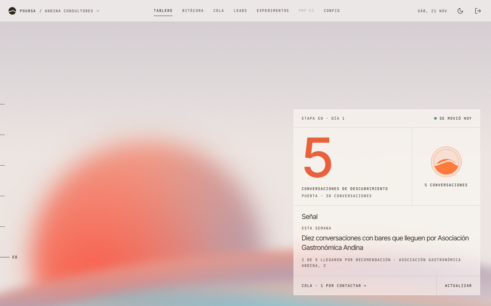

> **In English.** POURSA is a traction system for B2B companies whose product is finished
> but that still need their first paying customers. It turns what accelerators do — weekly
> cadence, stage gates, channel experiments, lead qualification and product-market-fit
> measurement — into a daily tool for the whole team. Each partner joins with a one-time
> code from their own phone and the app installs on the home screen, no app store needed.
> It automates everything *up to* the conversation with a customer and nothing beyond it:
> messages are copied, never sent automatically, and the system never promises results.
> Built with Java 21 and Spring Boot 4, audited against OWASP ASVS 5.0 level 2, and running
> as a pilot on its own server with HTTPS.

---

## El problema

Construir un producto hoy es más fácil que nunca. Venderlo, no. La mayoría de productos que
mueren no mueren por el código: **el 43% muere por falta de encaje con el mercado**, y la
mediana para llegar a US$1M de ingreso anual son 33 meses de distribución constante.

El síntoma es siempre el mismo: producto terminado, auditado, desplegable… y cero clientes
que pagan. Las aceleradoras resuelven eso con cadencia y criterio, pero cuestan, son
pocas y atienden a pocos. POURSA lleva ese método a un sistema.

Nació de un caso real, **PFM**, una aplicación de finanzas con el código terminado y ningún
cliente pagando. Hoy es un producto aparte: lo usan empresas que venden a otras empresas,
cada una con su equipo, y la primera prueba con una de ellas está en curso.

---

## Cómo funciona

### Una escalera, una métrica por etapa

Cada empresa está en una etapa. Cada etapa tiene **una sola métrica** y **una puerta**
que se comprueba con datos, no con opiniones.

| Etapa | Nombre | La métrica | La puerta |
|---|---|---|---|
| **E0** | Señal | Conversaciones de descubrimiento | 30 conversaciones |
| **E1** | Primeros 10 | Clientes pagando | 10 clientes pagando de verdad |
| **E2** | Repetibilidad | PMF · "muy decepcionados" | 40% o más, con al menos 40 respuestas |
| **E3** | Canal | Un canal con costo de adquisición sano | CAC menor que un tercio del valor del cliente |
| **E4** | Motor | Clientes que llegan por bucles | 30% de los nuevos |
| **E5** | Escala | Ingreso recurrente anual | US$1M |

Solo se ve la etapa actual: el mapa completo paraliza.

### Cinco motores

| Motor | Qué hace |
|---|---|
| **Diagnóstico** | Dice en qué etapa está la empresa, medido y no declarado. Desde la E2, con la encuesta de Sean Ellis. |
| **Objetivo** | La escalera: la métrica de la etapa, el semáforo, la meta de la semana y la graduación con evidencia. |
| **Canal** | El precio decide qué canales se pueden pagar. Los que no, se apagan con su porqué. |
| **Fábrica de leads** | Importa empresas del registro mercantil, las califica con reglas explicables y prepara el contacto. |
| **Aprendizaje** | Experimentos de canal con contrato: tope, fecha de corte, umbral y criterio de abandono, declarados antes de empezar. |

### Un equipo, dos papeles

| | Qué ve | Cómo entra |
|---|---|---|
| **Socio** | Tablero, Bitácora y Cola: lo que se usa todos los días | Con un código de un solo uso, desde su celular |
| **Operador** | Además, la Fábrica, los Experimentos, la Configuración, la PMF y las Empresas | Con usuario y clave |

Cada conversación queda con quién la tuvo, cómo llegó la empresa (la buscaron, alguien la
recomendó o ella escribió) y, si fue por recomendación, quién la recomendó. Así el Tablero
puede decir de dónde vienen las conversaciones, y no solo cuántas son.

---

## Las pantallas

### El equipo, desde el celular

<table>
<tr>
<td width="33%">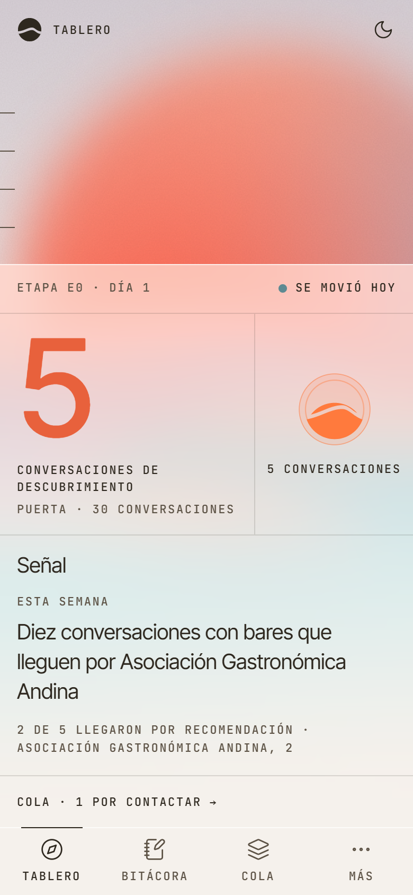</td>
<td width="33%">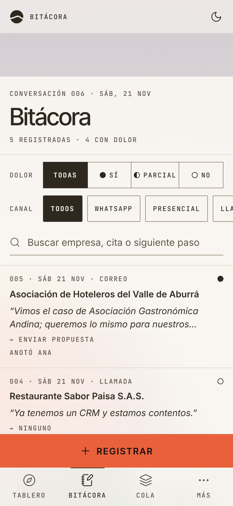</td>
<td width="33%">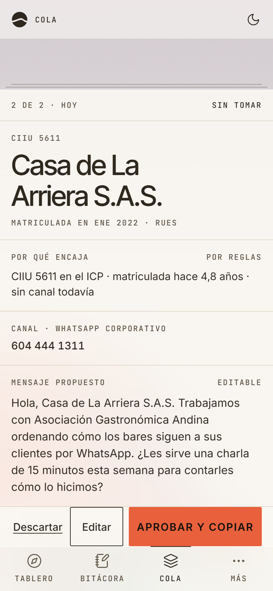</td>
</tr>
<tr>
<td><b>Tablero</b> · la métrica de la etapa, la meta de la semana y cuántas conversaciones llegaron por recomendación. Se pone al día solo cuando otro socio anota.</td>
<td><b>Bitácora</b> · cada conversación en menos de un minuto, con quién la anotó. Es lo que alimenta todo lo demás.</td>
<td><b>Cola</b> · compartida: copiar o descartar toma la empresa, y dos socios nunca le escriben a la misma. <b>Nada se envía solo.</b></td>
</tr>
</table>

### El operador, en el escritorio

<table>
<tr>
<td width="62%">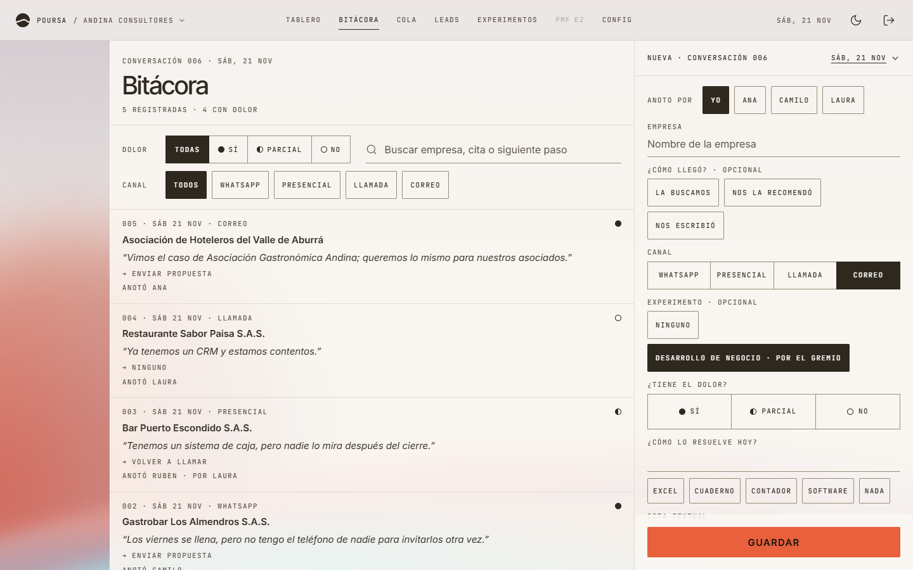</td>
<td><b>Bitácora.</b> La lista con filtros y búsqueda, y el formulario al lado. El operador
puede anotar por un socio («Anotó Ruben · por Laura») y cada conversación cuenta para quien
la tuvo. La empresa se autocompleta; si es nueva, se pregunta cómo llegó.</td>
</tr>
<tr>
<td>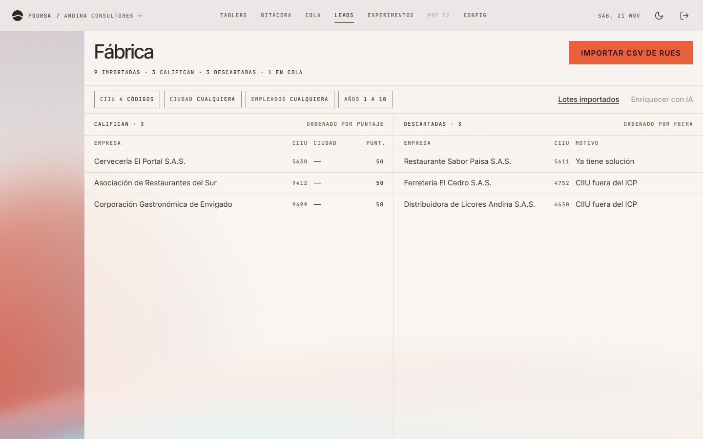</td>
<td><b>Fábrica de leads.</b> Importa el CSV del registro mercantil (RUES) con vista previa, y
califica cada empresa con reglas deterministas: actividad económica, ciudad, tamaño,
antigüedad y canal. <b>Descartar es la función principal</b>: las descartadas se muestran
con su motivo y con el mismo peso visual que las que califican. Las personas naturales no
entran nunca.</td>
</tr>
<tr>
<td>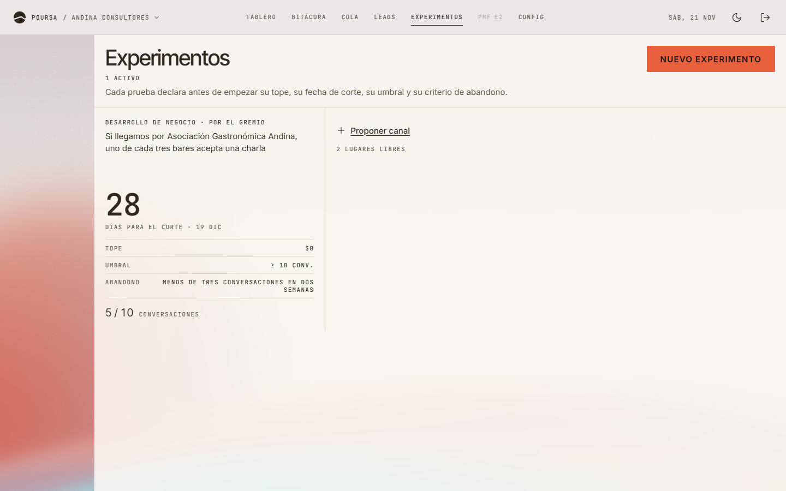</td>
<td><b>Experimentos.</b> Hasta tres a la vez, cada uno con su contrato. Cuando llega la fecha
de corte, el experimento solo se puede cerrar: ganador o abandonado, y lo aprendido es
obligatorio. El avance cuenta conversaciones reales, no actividad.</td>
</tr>
<tr>
<td>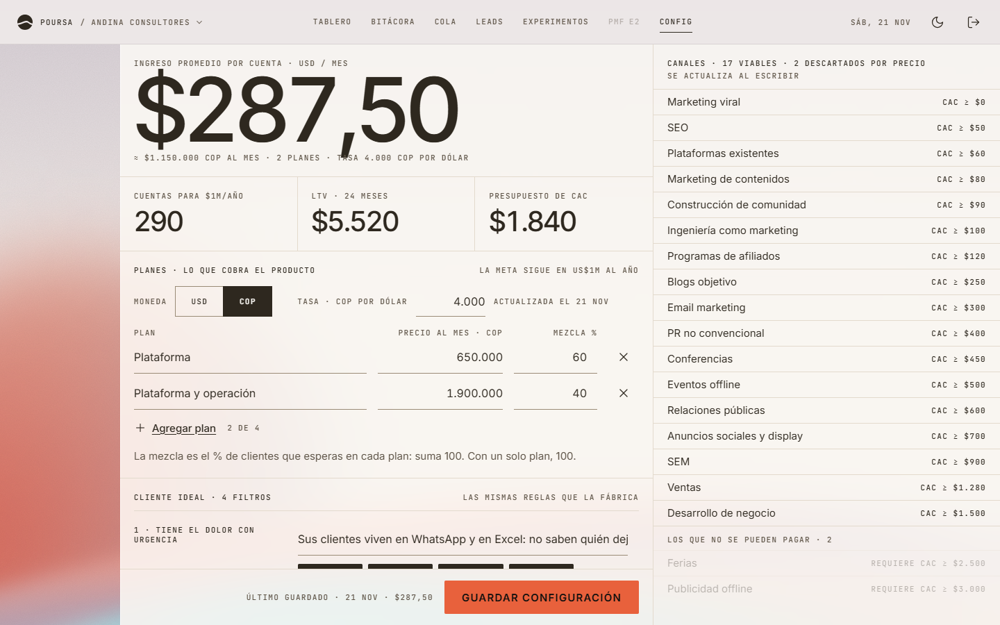</td>
<td><b>Configuración.</b> Los planes del producto en pesos o dólares, con su mezcla. De ahí
salen el ingreso promedio por cuenta, cuántas cuentas hacen falta para US$1M al año y el
presupuesto de adquisición que el precio permite. Con eso se decide qué canales se pueden
probar, y el cliente ideal que se escribe aquí es la misma regla que califica en la Fábrica.</td>
</tr>
<tr>
<td>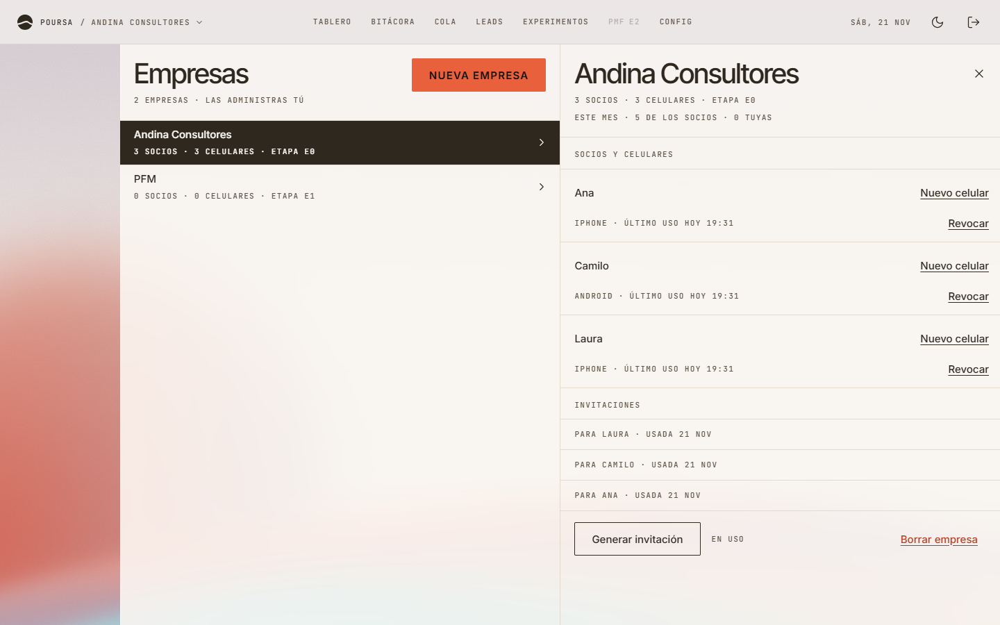</td>
<td><b>Empresas.</b> Crear una empresa, invitar a cada socio con un código que se muestra una
sola vez, ver sus celulares y revocar uno sin tocar a los demás. Arriba, la medida del mes:
cuántas conversaciones fueron de los socios y cuántas del operador. Borrar una empresa se
lleva todo lo suyo, y pide escribir su nombre.</td>
</tr>
</table>

### Entrar e instalar

<table>
<tr>
<td width="33%">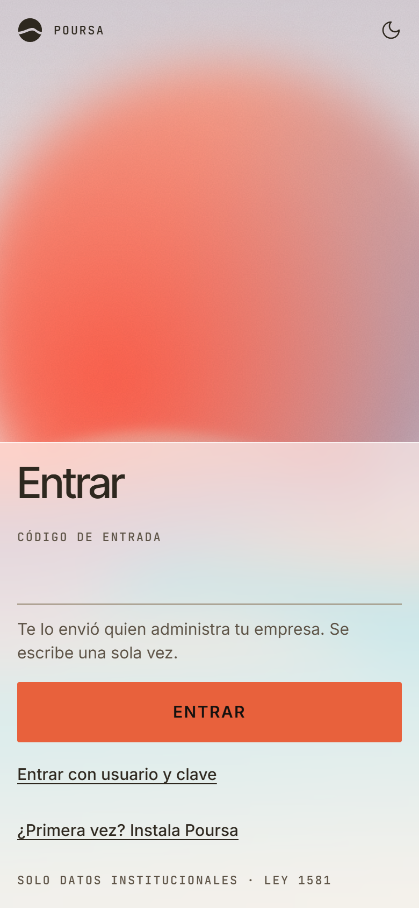</td>
<td width="33%">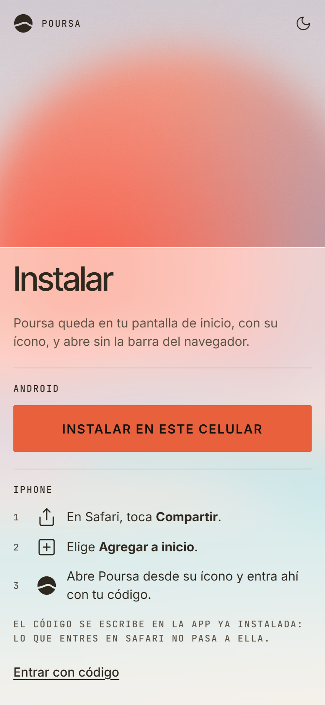</td>
<td width="33%">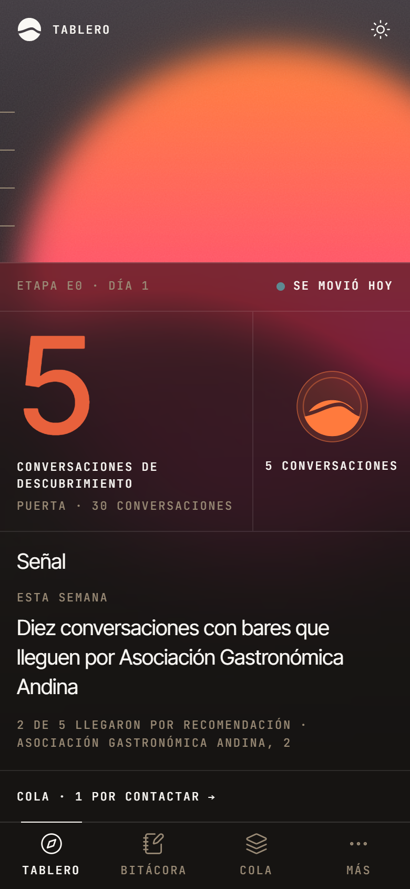</td>
</tr>
<tr>
<td><b>Entrar</b> · el código lo manda quien administra la empresa, y se escribe una sola vez por celular.</td>
<td><b>Instalar</b> · queda en la pantalla de inicio con su ícono y abre sin la barra del navegador. Sin tienda de aplicaciones.</td>
<td><b>Tema oscuro</b> · también en la barra de arriba del celular, que toma el color de la pantalla.</td>
</tr>
</table>

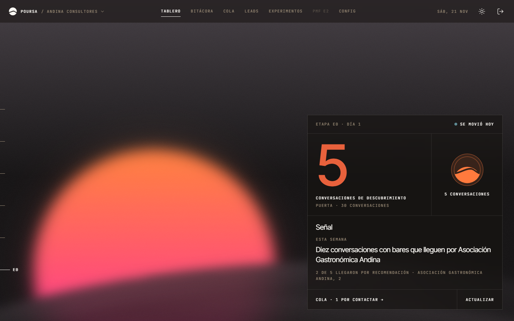

<b>Tema oscuro</b> · las dos apariencias se diseñaron a la vez, con los mismos contrastes mínimos de accesibilidad (WCAG AA). El estilo es propio: lo que el equipo todavía no ha tocado está desenfocado al fondo, y lo hecho va nítido, sobre cristal.

> La **PMF** (la encuesta de Sean Ellis, por rondas y por plan, con un enlace público que la
> empresa manda a sus clientes, en español o inglés y anónima por diseño) se activa en la
> E2. La empresa de las capturas está en E0, así que esa pantalla no aparece aquí.
> Todas las empresas y personas de las capturas son inventadas.

---

## Principios

Lo que POURSA **no** hace, a propósito:

- **No promete resultados.** Informa; no sabe si vas a vender. Ningún texto, ninguna
  pantalla y ningún dato promete reuniones ni ventas.
- **No automatiza la conversación con el cliente.** Consigue, califica y prepara; hablar
  le toca a una persona, porque ahí está todo el aprendizaje.
- **No envía nada por su cuenta.** Copia; la persona pega y envía.
- **No trabaja con datos personales.** Solo datos institucionales de empresas (Ley 1581
  de 2012 de Colombia): correo institucional y teléfono corporativo.
- **No lee la base de datos de nadie.** Recibe las métricas que el negocio escribe o
  exporta. Un producto que exige acceso a la base del cliente no se puede vender.
- **Puede decir "detén esto".** Si la métrica lleva semanas quieta, lo dice sin
  suavizarlo.

---

## Stack

| | |
|---|---|
| **Lenguaje** | Java 21 |
| **Framework** | Spring Boot 4.1 (Spring MVC, Spring Security 7, Spring Data JPA) |
| **Base de datos** | MySQL 8, con migraciones versionadas e idempotentes |
| **Interfaz** | Thymeleaf y HTMX 2, sin frameworks de JavaScript; tipografía y marca propias, generadas por código |
| **Celular** | Aplicación web instalable (manifiesto e íconos propios), en Android y iPhone |
| **Trabajos en segundo plano** | JobRunr |
| **IA** | Claude (Anthropic), opcional y desconectada por defecto, con gasto acotado por día y por lote |
| **Despliegue** | Docker en un servidor propio: imagen mínima con JRE, usuario sin privilegios, HTTPS automático con Caddy, MySQL sin publicar y respaldo nocturno probado restaurándolo |

La arquitectura es un **monolito modular organizado por funcionalidad**: cada motor es un
módulo con su lógica, sus vistas y sus datos, y los módulos se hablan por interfaces
pequeñas, sin dependencias circulares.

---

## Seguridad

Auditada contra **OWASP ASVS 5.0 nivel 2** y el **OWASP Top 10:2025**, con un control por
prueba automatizada siempre que se puede.

- **Entrada con código:** doce caracteres (60 bits de azar), de un solo uso y con fecha de
  vencimiento; en la base solo queda su huella. Cada celular recibe una llave de 256 bits
  en una cookie `HttpOnly` y `Secure`, revocable desde Empresas sin tocar a los demás. Los
  intentos fallidos se limitan por dirección y en total.
- **Operador:** sesión con cookie `HttpOnly`, `Secure` y `SameSite=Strict`, que rota al
  entrar y caduca. Bloqueo tras intentos fallidos, por usuario y dirección. Claves con bcrypt.
- **Permisos:** cada ruta pide su papel, y el servicio lo vuelve a comprobar. Cada consulta
  se filtra por la empresa de quien entró; el identificador de otra empresa responde 404,
  sin confirmar que exista.
- **Cabeceras:** CSP estricta sin scripts ni estilos en línea, `X-Frame-Options`,
  `nosniff`, HSTS, `Permissions-Policy` y `Cross-Origin-Opener-Policy`.
- **Datos:** SQL siempre con parámetros. Exportación a CSV protegida contra inyección de
  fórmulas.
- **La encuesta pública** usa un enlace de 256 bits revocable, CSRF, un límite de envíos
  por dirección y una respuesta 404 que no confirma si el enlace existió.
- **Dependencias:** escaneo con OWASP Dependency-Check contra la base del NVD; las
  versiones vulnerables se actualizan y cada excepción queda escrita, con fecha de
  vencimiento.
- **Base de datos:** la aplicación usa un usuario con solo lectura y escritura de filas,
  sin permiso para crear ni borrar tablas, y la conexión exige TLS.
- **IA:** sin llave, no hay cliente; los datos externos van delimitados en las
  instrucciones; un tope de gasto diario y por lote.

---

## Calidad

**670 pruebas automatizadas**, entre unitarias, de controladores y de integración contra
una base MySQL real: un recorrido completo que cruza todos los módulos, dos socios que
toman la misma empresa de la Cola al mismo tiempo, y lo que cada papel puede y no puede
abrir.

Cada pantalla se implementó a partir de una maqueta y se revisó en escritorio (incluidas
pantallas con escalado de Windows) y en el celular, en los dos temas. Antes de entregarlo,
un mes de uso de una empresa de prueba se simuló de punta a punta por la propia aplicación,
como lo haría una persona.

---

## Estado

**Construido y en piloto.** Las diez pantallas, el equipo con códigos y permisos, la Cola
compartida, la aplicación instalable y la integración con IA (desconectada por defecto).
Corre en su propio servidor con HTTPS, y la primera prueba con una empresa B2B, restringida
y sin costo, está empezando.

---

## Hoja de ruta

Lo siguiente **depende de la evidencia** que deje la primera prueba: POURSA crece solo cuando
el paso anterior demostró que hace falta. Mientras el equipo que lo prueba no registre
conversaciones nuevas, no se escribe código nuevo.

| Qué | Qué trae |
|---|---|
| **La prueba** | Cuatro semanas midiendo conversaciones nuevas, y los ajustes que pida el uso real. |
| **Internacional** | Importador de empresas de cualquier país, perfil legal por empresa (Colombia o Unión Europea), otros modelos de ingreso y la interfaz en inglés. |
| **Producto** | Diagnóstico gratuito y ejecución de pago, con un período de prueba. |

---

## Licencia

Software propietario. **Todos los derechos reservados.** Este repositorio muestra el
proyecto; no contiene su código y no concede ningún derecho de uso. Ver [LICENSE](LICENSE).

Para colaboración o licenciamiento: **Rubén Agudelo Alzate**.
